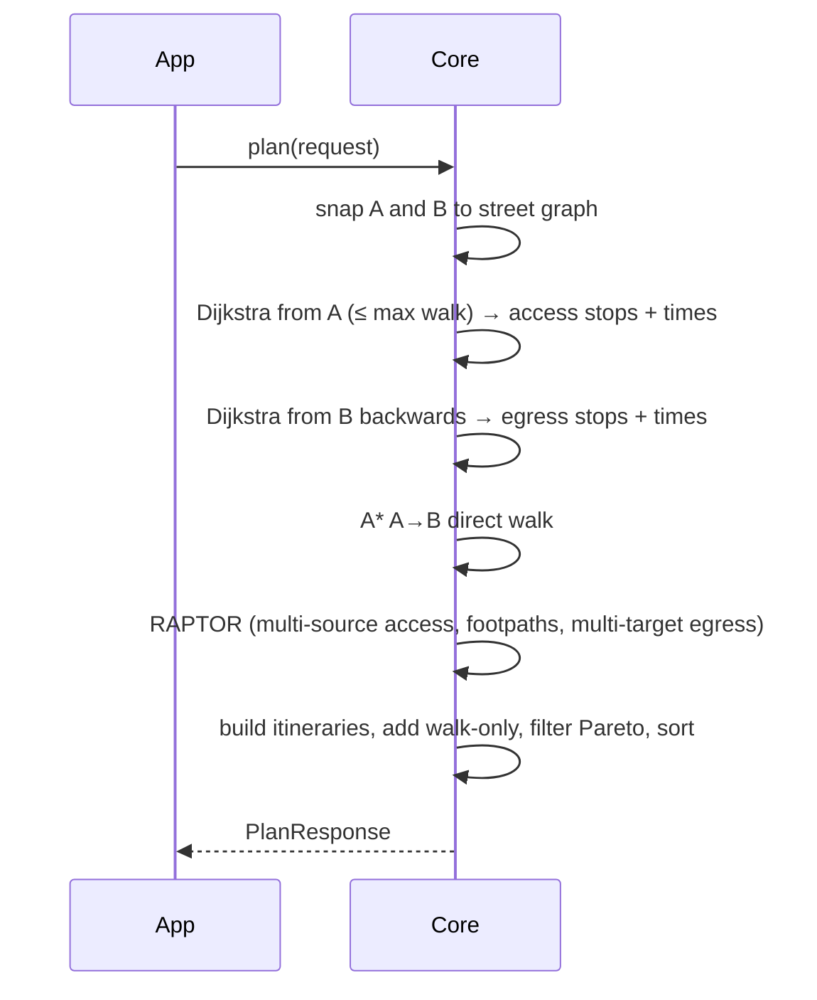
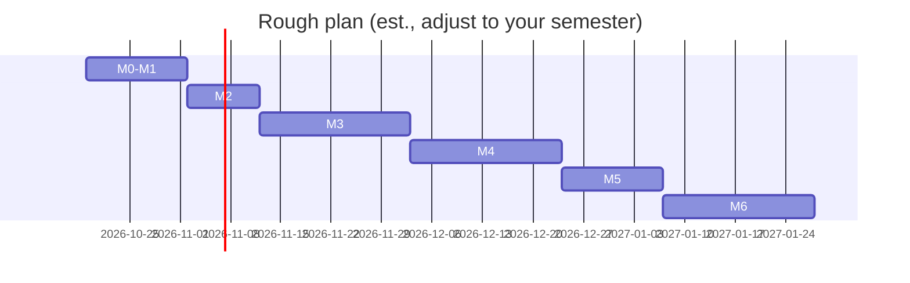

# Rustline — Specification (v0.1, draft)

> RoTransit's multimodal routing engine: GTFS public transport + walking, written in Rust.
> Status: **plan only, no code yet.** Author: Horia Savin. Date: 2026-10-14.
> Numbers marked **(est.)** are estimates to be checked by measurement, not facts.

---

## Table of contents
1. Purpose in one paragraph
2. Glossary (read this first)
3. Goals and non-goals
4. Use cases
5. Deployment decision (on-device vs server)
6. Architecture (workspace, crates, modules)
7. Data pipeline (GTFS + OSM → compact binary)
8. Algorithms and why
9. Multi-criteria: what "best journey" means
10. Time, calendars, timezone, DST, after-midnight
11. Public API (Rust, FFI/Dart, HTTP/JSON, errors)
12. Performance targets and size budgets
13. Integration with RoTransit (frontend + backend_v2)
14. Realtime (future)
15. Testing strategy
16. Tooling and CI
17. Milestones with acceptance criteria
18. Risks
19. Open questions for Horia
20. Sources

---

## 1. Purpose in one paragraph
Rustline answers one question: *"I am at point A at time T and want to get to point B — what should I do?"* The answer is a short list of itineraries. Each itinerary is a sequence of **legs**: walk to a stop, ride a bus, maybe walk to another stop, ride again, walk to B. If walking the whole way is as good or better, Rustline says so. It reads standard **GTFS** timetables (the same files RoTransit's backend already serves) and an **OpenStreetMap** street graph for walking. It is a standalone library first; the RoTransit Flutter app is its first user.

## 2. Glossary
| Term | Plain meaning |
|---|---|
| **GTFS** | "General Transit Feed Specification": a zip of CSV files (stops.txt, trips.txt, stop_times.txt, calendar.txt …) describing a timetable. [gtfs.org](https://gtfs.org/documentation/schedule/reference/) |
| **Stop** | A place where a bus stops (one side of the street). |
| **Route** (GTFS) | A line as the public knows it, e.g. "Line 4". |
| **Trip** | One single run of a bus along a route, with exact times. |
| **Stop pattern / RAPTOR route** | A group of trips that visit exactly the same sequence of stops. RAPTOR's "route" ≠ GTFS route. |
| **Service / calendar** | Which days a trip runs (calendar.txt = weekly rule, calendar_dates.txt = exceptions like holidays). |
| **Service day** | The "timetable day" a trip belongs to. A trip at 24:30:00 still belongs to the previous service day. |
| **Access leg** | Walking from point A to the first stop. |
| **Egress leg** | Walking from the last stop to point B. |
| **Transfer / footpath** | Walking between two stops to change bus. |
| **OSM** | OpenStreetMap, the free world map; we use its footways, streets and crossings. |
| **Graph** | Nodes (street corners) + edges (street pieces with a length). |
| **Dijkstra / A\*** | Classic shortest-path algorithms on a graph. A\* is Dijkstra with a "hint" (straight-line distance) so it explores less. |
| **RAPTOR** | Round-bAsed Public Transit Optimized Router — the transit algorithm we pick (see §8). |
| **Pareto set** | A set of answers where none is better in *every* way (e.g. one is faster, the other has fewer changes). |
| **FFI** | Foreign Function Interface: how Dart calls code compiled from Rust. |
| **flutter_rust_bridge (FRB)** | A tool that generates the Dart↔Rust glue code automatically. |
| **Crate / workspace** | Rust's package / a folder holding several packages built together. |
| **Golden test** | A test that compares output to a saved "known good" answer. |
| **Feed sha** | The SHA‑256 of a GTFS zip; backend_v2 already uses it as version id and ETag. |

## 3. Goals and non-goals
### Goals
- G1. Earliest-arrival journeys with few transfers and reasonable walking, for one city feed (Brașov/RATBV first).
- G2. Door-to-door: access walk, transit, transfer walks, egress walk, plus a pure-walk option.
- G3. Correct calendars (calendar.txt + calendar_dates.txt), trips after midnight, `frequencies.txt`, `transfers.txt`.
- G4. Run **offline on the phone** (see §5) with predictable memory, and also as a small HTTP server from the same code.
- G5. Deterministic, well tested, and explainable (good for a bachelor thesis).
- G6. Data versioned by the GTFS feed sha so the app knows when its routing data is stale.

### Non-goals (v1)
- Car, bike, scooter, taxi routing. (Design should not block bike later.)
- Realtime delays (GTFS‑RT) — planned as a future phase (§14).
- Fares, accessibility-only routing (wheelchair), turn-by-turn voice navigation.
- Multi-city / cross-feed journeys (e.g. Brașov → Sibiu trains). Single feed per query in v1.
- Map rendering or geocoding ("search an address"). The app gives coordinates.

## 4. Use cases
1. **UC1 — Plan now:** user taps "from my location" to a stop/point, departs now → 3–5 options.
2. **UC2 — Plan later / arrive by:** depart at 07:30 tomorrow, or arrive by 08:00 (arrive-by is phase 4).
3. **UC3 — Walk is better:** destination 400 m away → engine returns "Walk 6 min" first, not a bus.
4. **UC4 — Night / after midnight:** depart 23:50, ride a trip whose times are 24:10 → correct.
5. **UC5 — Holiday:** query on 1 December (Romanian national day) uses calendar_dates exceptions.
6. **UC6 — Stale data:** feed expired → engine returns a clear error/warning instead of wrong answers.
7. **UC7 — Developer:** CLI `rustline plan --from 45.64,25.59 --to 45.66,25.61 --at "2026-10-15T08:00"` prints itineraries (for debugging and thesis screenshots).

## 5. Deployment decision
| | **On-device (FRB, recommended)** | **Server (backend/home laptop)** |
|---|---|---|
| Works offline | Yes — matches RoTransit's offline pack design | No |
| Latency | No network; CPU of phone | Network + tunnel; fast CPU |
| Your server load / uptime risk | None | Home laptop + Cloudflare tunnel must be up |
| App size | + native library per ABI + routing data | No change |
| Data updates | App downloads new routing pack (sha) | Only server updates |
| Build complexity | Android NDK + iOS toolchains, FRB codegen | Plain Linux binary / Docker |
| Privacy | Location never leaves phone | Server sees trips |

**Recommendation:** **on-device first**, via flutter_rust_bridge 2.x, pinned to **2.12.0**. (2.13.0, released 2026‑08‑23, is the newest, but it requires Dart ≥ 3.9.2; RoTransit's Flutter is 3.27 / Dart 3.6, and 2.12.0 is the newest release that supports it (Dart ≥ 3.4). Move to 2.13+ together with a RoTransit Flutter upgrade — [releases](https://github.com/fzyzcjy/flutter_rust_bridge/releases), [pub.dev](https://pub.dev/packages/flutter_rust_bridge)). FRB supports Android/iOS via CargoKit. Reason: the app is already offline-first, Brașov is small, and it removes dependency on the home server.
**Keep server possible:** the core is a pure library (`rustline-core`) with no FFI/HTTP code; a thin `rustline-server` crate (axum) can expose the same API as JSON. Used for: debugging, thesis demo, other cities that are too big for a phone, or a web client.

Alternative considered: raw `dart:ffi` with a hand-written C ABI. Smaller dependency, but you would write and keep in sync all the glue by hand. FRB generates it. Keep raw FFI as fallback if FRB causes trouble.

## 6. Architecture
### 6.1 Overview
```mermaid
flowchart LR
  subgraph Offline build (PC / CI / backend)
    G[GTFS zip from /api/feeds] --> I[rustline-ingest]
    O[OSM .pbf extract Brașov] --> I
    I --> P[(routing pack .rlp)]
  end
  subgraph Phone
    P --> C[rustline-core]
    C --> F[rustline-ffi FRB]
    F --> D[Flutter app Dart]
  end
  P --> S[rustline-server axum, optional]
```

### 6.2 Cargo workspace layout
```
Rustline/
  Cargo.toml              # [workspace]
  crates/
    rustline-model/       # shared types: ids, time, geo, Itinerary, Request; serde
    rustline-gtfs/        # GTFS reading + validation -> normalised timetable
    rustline-osm/         # OSM pbf -> pedestrian graph
    rustline-pack/        # binary pack format: write + read (mmap/zero-copy)
    rustline-core/        # algorithms: street search, RAPTOR, itinerary assembly
    rustline-cli/         # `rustline build-pack`, `rustline plan`, `rustline inspect`
    rustline-ffi/         # flutter_rust_bridge API surface (thin)
    rustline-server/      # optional axum HTTP server (thin)
  tests/golden/           # golden itineraries (JSON)
  benches/                # criterion benchmarks
  data/fixtures/          # tiny hand-made GTFS + OSM for tests
  Documentation/Plan/Rustline-Spec.md
```
Rule: **only `rustline-core`, `-model`, `-pack` go on the phone.** `-gtfs` and `-osm` (heavy parsers) run at build time, keeping the phone library small.

### 6.3 Modules inside `rustline-core`
- `street/` — snapping a coordinate to the nearest walkable edge (R-tree, crate `rstar`), Dijkstra/A\* on the foot graph, one-to-many searches.
- `transit/raptor.rs` — RAPTOR rounds, labels, journey reconstruction.
- `transit/calendar.rs` — active services per date.
- `transit/frequencies.rs` — expanded trips from frequencies.txt (done at pack build).
- `plan.rs` — orchestration: access → RAPTOR → egress → walk-only comparison → ranking → `Itinerary`.
- `explain.rs` — debug info (stops explored, rounds, timings).

### 6.4 Query flow


## 7. Data pipeline
### 7.1 Inputs
- **GTFS**: from backend_v2 `GET /api/feeds` (list with `current.sha256`, `startsOn`, `expiresOn`) and `GET /api/feeds/{id}/file` (ETag = sha256). Current Brașov companion pack manifest says: 811 stops, 84 routes, 8 075 trips, 157 698 departure rows, 5 services, 110 service exceptions, feed valid 2026‑01‑23 → 2027‑05‑23, source RATBV via osm2gtfs (ODbL). These are facts from `frontend/assets/data/brasov_companion.manifest.json`.
- **OSM**: a Brașov extract (.osm.pbf), e.g. from Geofabrik's Romania file clipped with `osmium extract` to a bounding box around the feed's stops + margin (e.g. 2 km). [Geofabrik](https://download.geofabrik.de/europe/romania.html), [osmium](https://osmcode.org/osmium-tool/).

### 7.2 GTFS ingest (`rustline-gtfs`)
- Parse with the `gtfs-structures` crate (used by both `raptor` and `vulture` crates) [docs.rs](https://docs.rs/gtfs-structures). Alternative: own `csv` + `serde` reader if we need streaming/low memory.
- Validate: missing stop times, non-increasing times, unknown service ids, trips overtaking each other on the same pattern (RAPTOR requires no overtaking; split such patterns).
- Normalise: times as **seconds since service-day noon minus 12h** (GTFS definition, see §10) stored as `u32`, allowing >24:00.
- Build **stop patterns** (group trips by identical stop sequence), sort trips in each pattern by departure.
- Expand `frequencies.txt` into concrete trips (exact_times=1) or headway trips (exact_times=0 → expand with headway; mark as "approximate").
- Read `transfers.txt`: type 1/2 min times, type 3 forbidden. Treat as overrides on top of computed footpaths.

### 7.3 OSM ingest (`rustline-osm`)
- Read with `osmpbf` crate [docs.rs](https://docs.rs/osmpbf); `osm4routing` [GitHub](https://github.com/Tristramg/osm4routing2) is an option that already splits ways into routable edges.
- Keep ways walkable by pedestrians: `highway=footway|path|pedestrian|steps|living_street|residential|service|unclassified|tertiary|secondary|primary|track|crossing…`, exclude `motorway|trunk`, `foot=no`, `access=private` (unless `foot=yes`). Tag list to be tuned.
- Edge cost = length / walking speed (default 1.3 m/s **(est., configurable)**), steps penalty ×1.5 **(est.)**.
- Keep only the largest connected component (+ components containing stops), contract degree-2 nodes to shrink the graph, keep geometry for drawing.
- **Link stops**: snap each stop to the nearest edge (≤ 100 m **(est.)**); report stops that fail.

### 7.4 Precomputation
- **Footpaths between stops**: Dijkstra from each stop up to `max_transfer_walk` (default 500 m / ~6–7 min **(est.)**). For 811 stops this is cheap at build time. Make them transitively closed or let RAPTOR chain them (vulture notes both choices, [docs](https://docs.rs/vulture)).
- Fallback if OSM missing: straight-line distance × 1.3 detour factor **(est.)**.

### 7.5 Pack format (`.rlp` = Rustline pack)
- One file, little-endian, versioned header:
  `magic "RLPK" | format_version u16 | feed_sha256 [32] | osm_sha256 [32] | built_at | valid_from/to | timezone | section table`.
- Sections: stops, patterns, pattern_stops, trips (times as flat `u32` arrays), services (bitset per date over validity window), footpaths (CSR arrays), street graph (CSR nodes/edges + geometry), R-tree, string table (names, route short names, colours).
- Serialization: `rkyv` (zero-copy, mmap-able) **or** hand-written flat arrays with `bytemuck`. Decision in milestone M2 after a small benchmark. Compression: zstd for transport, decompressed once on device (like the current `.sqlite.gz`).
- **Versioning:** pack file name `rustline-{feedId}-{feed_sha[0..12]}-v{format}.rlp`; a pack is valid only if its `feed_sha256` equals the backend's `current.sha256`. Format version bumps on any breaking layout change; the core refuses unknown versions with `PackError::UnsupportedVersion`.
- Size for Brașov **(est.)**: timetable ~2–5 MB raw, street graph ~5–15 MB raw, ~3–8 MB zstd. To be measured in M2.
- **M2 decision (2026-10-14): `rkyv` 0.8** (needs Rust 1.81, inside MSRV 1.85) for the body, behind a small hand-written header: `magic "RLPK" | format_version u16 | feed_sha256 [32] | osm_sha256 [32] | built_at i64 | valid_from i32 | valid_to i32 (days since 1970-01-01) | timezone (u16 len + UTF-8) | feed_id (u16 len + UTF-8) | body_len u64 | body | crc32 u32`. Format version **2** since the M2 review (v1 had no checksum). The CRC32 (crc32fast) covers every byte before it and is checked on read (`Corrupt("body checksum mismatch")`). The body may be at most 256 MiB by default (`read_pack_with_limit` / `Engine::from_bytes_with_limit` change it); a `.rlp.zst` whose frame declares a bigger size is refused before decompressing, and the stream is decompressed straight into the aligned body buffer (no extra copy), which grows 1 MiB at a time as data arrives (the header's length is never trusted for allocation). `build-pack` writes the content size into the frame. The body is one rkyv archive of `TimetableData` (flat CSR arrays of `u8`/`u16`/`u32`/`u64` + strings; coordinates as `f64::to_bits`). There is no section table yet: with one archive there is only one section; it comes with the street graph in M4. `bytemuck` flat arrays were **not** benchmarked: rkyv loads Brașov in under 1 ms (median), about 600× under the 500 ms phone budget, so hand-writing the layout would not pay off. `read_pack` copies the body into an aligned buffer, validates it (bytecheck), then checks every CSR offset and index, so a damaged file gives `PackError::Corrupt`, never a panic. Building with `--built-at` or `SOURCE_DATE_EPOCH` gives byte-identical packs.
- **Measured (M2, PC, release, timetable only, zstd level 19):**
  - Build/size: `target/release/rustline build-pack --gtfs fixtures/feeds/<feed>.zip --out /tmp/rl_m2/<feed> --feed-id <feed> --built-at 1700000000` (wall time and peak RSS via Python `resource.getrusage`).
  - Load: `RUSTLINE_MANIFEST_FEED=fixtures/feeds/<feed>.zip cargo test --locked --release -p rustline-core --test engine -- --ignored --nocapture` (median of 10 `Engine::from_bytes`, uncompressed bytes in memory).

  | Feed | stop_times (packed) | `.rlp` | `.rlp.zst` | build | peak RAM (build) | `Engine::from_bytes` median of 10 |
  |---|---|---|---|---|---|---|
  | Brașov (`fixtures/feeds/brasov-manifest.zip`) | 118 534 | 1 702 337 B (1.7 MB) | 166 858 B (167 KB) | 0.41 s | 74 MB | 0.81 ms |
  | Cluj | 231 429 | 3 082 966 B | 317 759 B | 0.67 s | 119 MB | – |
  | Timișoara | 206 136 | 2 723 059 B | 217 058 B | 0.66 s | 103 MB | – |
  | București | 1 450 165 | 16 397 723 B | 1 460 342 B | 4.91 s | 412 MB | – |
  | MBTA (Boston) | 3 133 078 (packed; 3 133 085 raw rows) | 31 806 758 B | 1 770 850 B | 7.17 s | 746 MB | 14.99 ms |

  (Re-measured 2026-10-14 after adding the CRC32 trailer and the zstd frame checksum; load includes the CRC pass.)

### 7.6 Where packs are built
Phase 1: on your PC with `rustline build-pack`. Later: backend_v2 (or a CI job) builds a pack when a new feed sha appears and serves it at e.g. `/api/feeds/{id}/routing-pack` with the same ETag logic. Bundle one pack in the app like `brasov_companion.sqlite.gz`.

## 8. Algorithms and why
| Algorithm | Idea | Verdict |
|---|---|---|
| **RAPTOR** (Delling, Pajor, Werneck 2012, [paper](https://www.microsoft.com/en-us/research/publication/round-based-public-transit-routing/)) | Rounds = number of rides; scan each pattern once per round; arrays, no heap; naturally gives arrival-time × transfers Pareto set | **Chosen.** Simple, fast, no heavy preprocessing, ideal for a thesis. Existing Rust references: `raptor` crate [crates.io](https://crates.io/crates/raptor), `vulture` [GitHub](https://github.com/urschrei/vulture). |
| **McRAPTOR** (same paper) | RAPTOR with bags of labels for more criteria (e.g. walking) | Phase 4, for walking as 3rd criterion. |
| **rRAPTOR** (range) | Run for many departure times, reuse labels | Phase 4 ("leave between 8:00–8:30"). |
| **CSA** (Connection Scan, Dibbelt et al. 2013, [arXiv](https://arxiv.org/abs/1703.05997)) | Sort all departures, scan once | Very simple and fast for earliest arrival, but transfers criterion is less natural. Good as **test oracle** (second implementation to cross-check RAPTOR). |
| **Trip-Based (TB)** (Witt 2015) | Precompute trip-to-trip transfers | Faster queries, more preprocessing; unnecessary for a city of Brașov's size. |
| **ULTRA** (Baum et al. 2019, [arXiv](https://arxiv.org/abs/1906.04832)) | Precomputed shortcuts allow unlimited walking transfers | Overkill for v1; note as future if walking limits are raised. |
| **Dijkstra / A\*** | Street shortest paths | Chosen for access, egress, footpaths and walk-only. Bidirectional/CH not needed at city scale. |

Existing engines studied (for ideas, not as dependencies): **OpenTripPlanner** (Java, uses RAPTOR since v2 — [docs](https://docs.opentripplanner.org/)), **R5** (Java, Conveyal, RAPTOR-based — [GitHub](https://github.com/conveyal/r5)), **MOTIS / nigiri** (C++, powers Transitous — [GitHub](https://github.com/motis-project/motis), [transitous.org](https://transitous.org/); Rust bindings `motis-nigiri` exist), **Valhalla** (C++, street + multimodal — [GitHub](https://github.com/valhalla/valhalla)). Why not just use one: OTP/R5 are JVM servers (not on-device); MOTIS/Valhalla are large C++ codebases, hard to cross-compile to phones and less valuable as *your* thesis work.

### 8.1 Query algorithm in detail
1. Snap A and B to the street graph (nearest edge via R-tree; if > 300 m **(est.)** from any edge → `Error::OutsideCoverage`).
2. Forward Dijkstra from A until `max_access_walk` (default 1 000 m **(est.)**) → list of (stop, walk_seconds). Backward Dijkstra from B → egress list.
3. Direct walk A→B with A\* (stop if longer than `max_walk_only`, default 3 km **(est.)**).
4. RAPTOR: initialise round 0 with `t_dep + access_time` at each access stop; per round: scan marked patterns (earliest catchable trip, boarding with `min_board_slack` default 0 s, honour pickup/drop_off_type), then relax footpaths and transfers.txt; stop after `max_transfers+1` rounds or no improvement. Targets: for each egress stop, candidate arrival = stop arrival + egress walk; keep best per round (per number of rides).
5. Reconstruct legs from back-pointers; merge with real walking geometries.
6. Add walk-only itinerary; apply Pareto filter and dominance rules of §9; sort.
7. Optional: second pass "depart as late as possible" for the found arrival (reduces waiting at stops).

## 9. Multi-criteria
v1 criteria: **arrival time** and **number of rides** (RAPTOR native). Walking handled by limits + tie-breaking. v2 (McRAPTOR): add **total walking time** as third criterion.
Ranking rules (configurable):
- Walk-only wins if `walk_arrival ≤ best_transit_arrival + walk_bonus` (default 3 min **(est.)**) — people prefer walking a bit longer to waiting for a bus.
- Drop an itinerary with one more transfer unless it arrives ≥ `transfer_penalty` (default 5 min **(est.)**) earlier.
- Return at most `max_results` (default 5).
- Tie-break: less walking, then later departure, then fewer stops.

## 10. Time, calendars, timezone, DST, after midnight
- Agency timezone from agency.txt; for RATBV `Europe/Bucharest` (EET UTC+2 / EEST UTC+3). Use `chrono` + `chrono-tz` (or `jiff`) at the API boundary only. Internally: `(service_date, seconds)`.
- GTFS rule: times are measured from "noon minus 12h" of the service day, so on DST change days a time like 03:00 is still well defined [GTFS reference](https://gtfs.org/documentation/schedule/reference/#stop_timestxt). Implement exactly that; test on 2027‑03‑28 and 2026‑10‑25 (EU DST switch dates).
- After midnight: a query at 00:20 on day D must look at trips of service day D **and** service day D‑1 with times ≥ 24:00. Implementation: RAPTOR runs over a time axis in absolute seconds; for each pattern consider active trips of D‑1 (their times shifted by −86 400 s, i.e. one day earlier) and D (and D+1 for long searches).
- Services: precomputed per-date bitset over the feed's validity window; `calendar_dates` type 1 adds, type 2 removes.
- Query outside feed validity → `Error::DateOutsideFeed { valid_from, valid_to }`.
- Response times are ISO‑8601 with offset (e.g. `2026-10-15T08:04:00+03:00`).

## 11. Public API
### 11.1 Rust (`rustline-core`)
```rust
pub struct Engine { /* loaded pack, caches */ }

impl Engine {
    pub fn open(path: &Path) -> Result<Engine, PackError>;
    pub fn from_bytes(bytes: Vec<u8>) -> Result<Engine, PackError>;
    pub fn info(&self) -> PackInfo;               // feed sha, validity, counts
    pub fn plan(&self, req: &PlanRequest) -> Result<PlanResponse, PlanError>;
    pub fn nearest_stops(&self, at: LatLon, radius_m: u32, limit: u16) -> Vec<StopRef>;
}

pub struct PlanRequest {
    pub from: LatLon, pub to: LatLon,
    pub time: TimeSpec,                 // DepartAt(DateTime) | ArriveBy(DateTime) (phase 4)
    pub max_transfers: u8,              // default 3
    pub max_access_walk_m: u32,         // default 1000 (est.)
    pub max_transfer_walk_m: u32,       // default 500 (est.)
    pub walk_speed_mps: f32,            // default 1.3 (est.)
    pub max_results: u8,                // default 5
    pub include_geometry: bool,
}

pub struct PlanResponse { pub itineraries: Vec<Itinerary>, pub warnings: Vec<Warning>, pub debug: Option<DebugInfo> }
pub struct Itinerary { pub departure: DateTime, pub arrival: DateTime, pub duration_s: u32,
                       pub transfers: u8, pub walk_m: u32, pub legs: Vec<Leg> }
pub enum Leg {
    Walk    { from: Place, to: Place, start: DateTime, end: DateTime, distance_m: u32, geometry: Option<Polyline> },
    Transit { route_id: String, route_short_name: String, headsign: Option<String>, trip_id: String,
              from_stop: StopRef, to_stop: StopRef, board: DateTime, alight: DateTime,
              intermediate_stops: Vec<StopRef>, geometry: Option<Polyline> },
}
```
`Engine` is `Send + Sync`; per-query scratch memory comes from a pool so concurrent queries (server) are safe.

### 11.2 Errors
```rust
pub enum PackError { Io, BadMagic, UnsupportedVersion { found: u16, supported: u16 }, Corrupt(String) }
pub enum PlanError {
    OutsideCoverage { which: Endpoint },          // A or B too far from streets
    DateOutsideFeed { valid_from: NaiveDate, valid_to: NaiveDate },
    NoRoute,                                      // nothing within limits (walk-only too long)
    InvalidRequest(String),
}
pub enum Warning { FeedExpiresSoon { on: NaiveDate }, ApproximateFrequencyTrip, StopNotLinkedToStreets(String) }
```

### 11.3 Dart (via FRB, `rustline-ffi`)
```dart
final engine = await RustlineEngine.open(path: packPath);
final res = await engine.plan(req: PlanRequest(from: LatLon(45.64, 25.59), to: LatLon(45.66, 25.61),
    departAt: DateTime.now(), maxResults: 5));
```
Calls run on a Rust thread (FRB async), never blocking the UI. Errors arrive as Dart exceptions with the same variant names.

### 11.4 HTTP JSON (`rustline-server`, optional)
`POST /v1/plan`
```json
{ "from": {"lat":45.6427,"lon":25.5887}, "to": {"lat":45.6579,"lon":25.6012},
  "departAt": "2026-10-15T08:00:00+03:00", "maxTransfers": 3, "maxResults": 5, "includeGeometry": true }
```
Response:
```json
{ "feedSha256": "…", "itineraries": [ {
    "departure": "2026-10-15T08:02:00+03:00", "arrival": "2026-10-15T08:27:00+03:00",
    "durationS": 1500, "transfers": 0, "walkM": 640,
    "legs": [
      {"mode":"WALK","from":{"name":"Origin"},"to":{"stopId":"123","name":"Livada Poștei"},
       "start":"…","end":"…","distanceM":320,"geometry":"<encoded polyline>"},
      {"mode":"BUS","routeShortName":"4","headsign":"Triaj","tripId":"…",
       "from":{"stopId":"123"},"to":{"stopId":"456"},"board":"…","alight":"…","intermediateStops":[…]},
      {"mode":"WALK", "…": "…"} ] } ],
  "warnings": [] }
```
Errors: HTTP 400 `{"error":"INVALID_REQUEST"}`, 404 `NO_ROUTE`, 422 `OUTSIDE_COVERAGE` / `DATE_OUTSIDE_FEED`. A JSON Schema file `schema/plan.v1.json` is generated from the Rust types (crate `schemars`) so app and server cannot drift. `GET /v1/info` returns `PackInfo`.

## 12. Performance targets and budgets (all est., to be validated in M5)
| Metric | Target |
|---|---|
| Query p95 on mid-range Android (e.g. Galaxy A5x) | < 150 ms |
| Query p95 on PC | < 20 ms |
| Pack load (mmap/decompress) on phone | < 500 ms, once per app start |
| RAM during query | < 30 MB above pack size |
| Native library size per ABI (arm64) | < 4 MB stripped, release, LTO |
| Pack size compressed (Brașov) | < 10 MB |
| Pack build time on PC | < 60 s |
Release profile: `opt-level=3`, `lto="fat"`, `codegen-units=1`, `panic="abort"` (except in FFI where we catch panics), `strip=true`. Ship only `arm64-v8a` (+ `armeabi-v7a`, `x86_64` if needed) via Android App Bundle splits.

## 13. Integration with RoTransit
- **Frontend:** new `features/journey/` (planner screen, results list, map polyline using existing flutter_map). Rustline added as an FRB plugin package (`rustline_flutter`), kept in the Rustline repo, referenced by path/git from `frontend/pubspec.yaml`.
- **Data:** bundled `brasov.rlp.zst` next to `brasov_companion.sqlite.gz`; on startup compare its `feed_sha256` with `/api/feeds` current sha (already used by the companion pack logic). Mismatch → download new pack when backend supports it; meanwhile show "timetable may be outdated" warning.
- **Stop IDs:** Rustline uses GTFS `stop_id`, same as the companion pack, so the app can link results to existing stop boards and favourites.
- **Backend (later):** endpoint serving packs, built by a scheduled job after feed download (FeedService already detects new sha).

## 14. Realtime (future)
GTFS‑RT TripUpdates (delays) would be applied as a per-trip delay overlay without rebuilding the pack. RAPTOR's "no overtaking" assumption can break with delays → fallback: re-sort affected patterns per query. Not in v1; RATBV realtime availability is an open question.

## 15. Testing strategy
- **Unit tests:** calendar resolution, time parsing (`25:10:00`), DST days, pattern building, overtaking split, footpath generation, snapping.
- **Fixture networks:** tiny hand-written GTFS (5 stops, 3 routes) + tiny OSM where the right answer is obvious by hand. Include: transfer needed, walk better than bus, after-midnight trip, holiday removal, frequencies, forbidden transfer.
- **Golden itineraries:** ~30 real Brașov queries (Gară → Centru, Triaj → Livada Poștei, night trip …) checked once by you against RATBV timetables / Google Maps, saved as JSON in `tests/golden/`. Test fails if output changes; intentional changes are re-approved (crate `insta`).
- **Property tests (`proptest`):** random queries on Brașov; assert: arrival ≥ departure; legs are continuous in time and place; no ride boards before arrival at stop; result never worse than walk-only; RAPTOR earliest arrival == CSA oracle earliest arrival.
- **Pack round-trip:** build → load → identical counts and sample trips; fuzz the loader (`cargo fuzz`) so corrupt files return errors, never crash.
- **Benchmarks:** `criterion` with 1 000 fixed random queries; tracked in CI to spot regressions.
- **FFI smoke test:** Flutter integration test that opens the pack and runs one plan on Android emulator.

## 16. Tooling and CI
- Rust stable via `rust-toolchain.toml`; `cargo fmt --check`, `cargo clippy -- -D warnings`, `cargo test --workspace`, `cargo deny` (licences/advisories), `cargo doc`.
- GitHub Actions: `ci.yml` (fmt, clippy, test on Linux), `bench.yml` (manual), `android.yml` (build `rustline-ffi` for `aarch64-linux-android` with `cargo-ndk`), later iOS on macOS runner. Dependabot for cargo + actions (as in RoTransit).
- Licence: suggest MIT or Apache‑2.0 for code. Note data licences: OSM is ODbL, RATBV GTFS (osm2gtfs) also ODbL → attribution needed in the app.
- Commits only by Horia Savin; branch + PR flow like RoTransit.

## 17. Milestones
| # | Phase | Deliverable | Acceptance criteria |
|---|---|---|---|
| M0 | Setup | Workspace skeleton, CI green, README, licence | `cargo test` passes in CI; fmt/clippy enforced |
| M1 | GTFS ingest | `rustline inspect feed.zip` prints counts, validation report | Counts equal the companion manifest (811 stops, 8 075 trips …) |
| M2 | Pack v1 (timetable only) | `build-pack`, loader, format decision (rkyv vs flat) | Round-trip test; size and load time measured and written in this spec |
| M3 | RAPTOR stop-to-stop | `rustline plan --from-stop X --to-stop Y` | Fixture tests + 10 golden stop-to-stop queries pass; CSA oracle agrees on 1 000 random queries |
| M4 | Streets | OSM ingest, snapping, Dijkstra, footpaths, access/egress, walk-only | Door-to-door golden tests (incl. "walk is better") pass; all stops linked or reported |
| M5 | Calendar & edge cases | after-midnight, DST, holidays, frequencies, transfers.txt | Dedicated tests for each pass; benchmarks meet §12 on PC |
| M6 | Flutter integration | FRB plugin, Android build, planner screen prototype | Plan query runs on your Samsung A54 offline; p95 measured |
| M7 | Server (optional) | axum `/v1/plan`, Docker image | JSON schema test; same results as library |
| M8 | Quality+ | McRAPTOR walking criterion, arrive-by, range queries | Golden tests updated; thesis-ready docs and benchmark charts |
| M9 | Future | Pack served by backend_v2, realtime overlay, multi-city | Separate spec |



## 18. Risks
| Risk | Effect | Mitigation |
|---|---|---|
| osm2gtfs-derived RATBV feed has wrong/approximate times | Bad answers | Validation report; golden tests vs official timetables |
| FRB / NDK / iOS build pain | Delays M6 | Start a hello-world FRB build early (in M0/M1 side task); raw FFI fallback |
| Pack too big / slow on phone | Bad UX | Measure in M2/M4; contract street graph; drop geometry, compute it server side |
| Overtaking trips break RAPTOR | Wrong results | Split patterns at build time |
| OSM gaps (missing footways) | Detours or no route | Fallback straight-line ×1.3; report unlinked stops |
| Scope creep (bikes, realtime, multi-city) | Thesis late | Non-goals list; M8+ only after M6 |
| Learning Rust while building | Slower | Small milestones; reference crates `raptor`/`vulture` to compare |

## 19. Open questions for Horia
1. Confirm **on-device first** (with server kept possible)? Or do you want the server first because it is easier to demo?
2. Is Rustline only for RoTransit, or a public open-source project (affects licence, API stability, crates.io publishing)?
3. Only Brașov for the thesis, or must the other 12 Romanian feeds work too (size/perf targets change)?
4. iOS needed for the thesis, or Android only?
5. Who builds packs long-term: your PC, GitHub Actions, or backend_v2 on the server laptop?
6. Defaults: walking speed, max walk to a stop, max transfers — any preference (e.g. elderly-friendly mode)?
7. Is arrive-by ("be there by 8:00") a v1 must-have?
8. Does RATBV publish realtime data at all?
9. Should walk-only be shown always, or only when it is competitive?
10. Do you want to write the core yourself (learning) with me reviewing, or should I scaffold M0–M1?

## 20. Sources
- Delling, Pajor, Werneck — *Round-Based Public Transit Routing* (RAPTOR/McRAPTOR): https://www.microsoft.com/en-us/research/publication/round-based-public-transit-routing/
- Dibbelt, Pajor, Strasser, Wagner — *Connection Scan Algorithm*: https://arxiv.org/abs/1703.05997
- Baum, Buchhold, Sauer, Wagner, Zündorf — *ULTRA*: https://arxiv.org/abs/1906.04832
- Witt — *Trip-Based Public Transit Routing*: https://arxiv.org/abs/1504.07149
- GTFS Schedule reference: https://gtfs.org/documentation/schedule/reference/
- `raptor` crate: https://crates.io/crates/raptor · `vulture` crate: https://github.com/urschrei/vulture
- `gtfs-structures`: https://docs.rs/gtfs-structures · `osmpbf`: https://docs.rs/osmpbf · osm4routing2: https://github.com/Tristramg/osm4routing2
- flutter_rust_bridge 2.12.0 (pinned; 2.13 needs Dart 3.9): https://github.com/fzyzcjy/flutter_rust_bridge/releases/tag/v2.12.0
- OpenTripPlanner: https://docs.opentripplanner.org/ · R5: https://github.com/conveyal/r5 · MOTIS: https://github.com/motis-project/motis · Transitous: https://transitous.org/ · Valhalla: https://github.com/valhalla/valhalla
- Geofabrik Romania extract: https://download.geofabrik.de/europe/romania.html
- RoTransit: `frontend/assets/data/brasov_companion.manifest.json`, `backend_v2/.../FeedController.java` (`/api/feeds`, `/{id}/file`, ETag = sha256)
